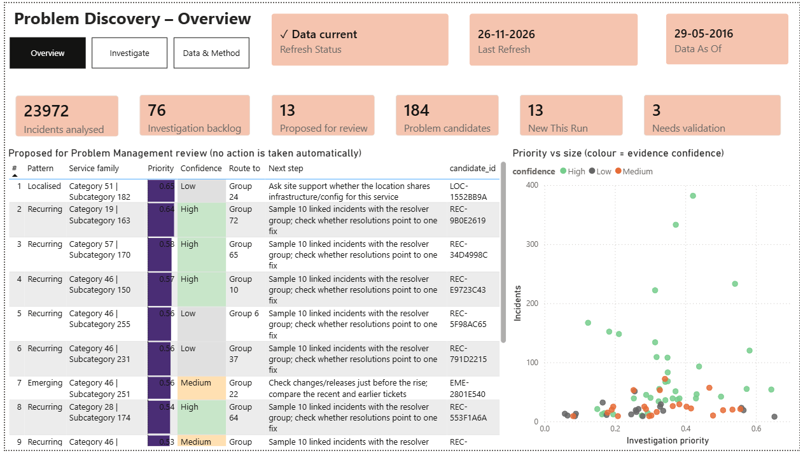
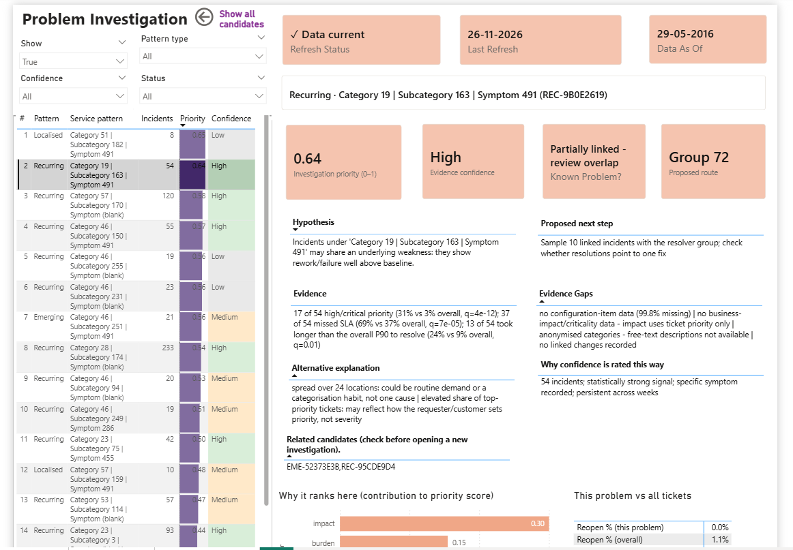
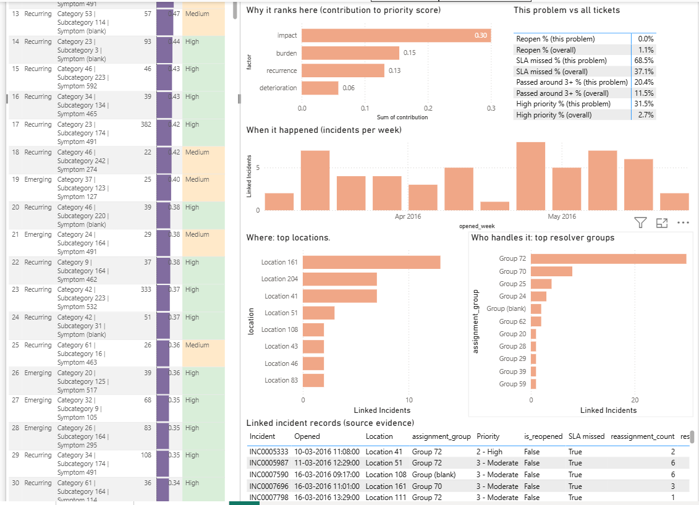
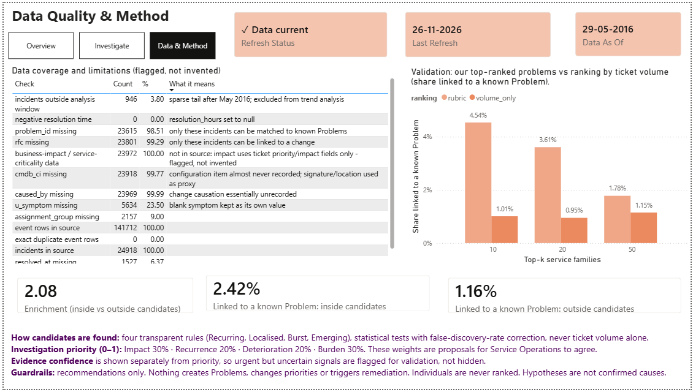

# Proactive Problem Discovery from Incident Data

**Can you find the problems we don't know we have?**
A repeatable analysis that connects apparently separate incidents into evidence-backed
*problem candidates*, compares them with known Problems, and proposes an explainable
investigation order for Service Operations, with a Power BI dashboard on top.

Each dataset has a clear role, chosen after checking what its fields actually support:

| Dataset | What it is | Role |
|---|---|---|
| **UCI** ServiceNow event log | anonymised corporate IT incidents: 23,972 analysed (Feb–May 2016) | **Main operational source**: problem detection, recurrence, reopens, resolution time, SLA, known-Problem/change links |
| **Mendeley** Help Desk Tickets | software company's customer helpdesk: 11,691 tickets analysed (2021–2023), full status history | **Second detection source** plus resolution patterns (time per workflow step) and handoffs |
| **Zenodo** IT Support Tickets | 2,229 real ticket texts in 4 languages, human-labelled into 7 categories | **NLP**: text similarity, clustering, description analysis, category-based comparison |
| Synthetic (generated) | 3,020 tickets with descriptions + 5 planted problems | ground truth for the text method |

What each dataset can and can't support (checked against the data):

| Use | Support | Note |
|---|---|---|
| UCI recurrence, resolution time | ✅ | core of the pipeline |
| UCI reopens | ✅ thin | 265 reopened incidents (1.1%) |
| UCI SLA | ⚠️ partial | met/missed flag only: shows *where* SLA is missed, not by how much |
| UCI problem & change links | ⚠️ thin | 357 incidents → 230 Problems; 171 incidents → 169 changes; no change/Problem records themselves, so no change-induced analysis |
| Mendeley resolution patterns, handoffs | ✅ | handoffs reported as counts per service, never per person |
| Mendeley conversations | ⚠️ not used | only 360 masked tickets, sampled for a staff-appraisal study. Zenodo covers text instead |
| Zenodo text | ✅ | no timestamps, so no trends or bursts; categories are topics, not Problems |

> Recommendations here are **proposals for human review**. The pipeline never creates Problems,
> changes incident priorities or triggers remediation, and it never analyses individual employees.

---

## Results at a glance

| | UCI | Mendeley |
|---|---|---|
| Problem candidates → backlog items (deduplicated by service family) | 184 → **76** | 49 → **23** |
| Proposed escalations (priority ≥ 0.45) | 13, routed to the dominant resolver group | 13, routed to the product's service owner (groups not recorded) |
| Partial ground truth (never used as a signal) | linked to a known Problem | closed as Duplicate |
| Label enrichment inside vs outside candidates | **2.1×** | **3.1×** |
| Top-10 families vs top-10 by volume (label rate) | **4.5% vs 1.0%** | **2.6% vs 2.1%** |

Text, synthetic: mean F1 **0.89** recovering planted problems vs **0.14** for category grouping.
Text, real (Zenodo): the 762 "Support general" tickets hide **28 sub-themes**, including 21 monitoring
alerts (host UP → DOWN) and 38 security-scan tickets; **9 near-duplicate groups** carry inconsistent human
categories; a simple classifier reaches **0.83 accuracy / 0.81 macro-F1** vs the published 0.79 / 0.72.
Tests: **45 passing** (`pytest`).

## Dashboard (Power BI)

`ProblemInvestigation.pbix`: three pages, built around one interaction: **select a potential
problem and inspect its evidence.**

**Overview:** the situation at a glance. KPIs (incidents analysed, backlog, proposed for review,
new this run, *high priority but low confidence → needs validation*), the escalation proposals, and
a priority-vs-size triage chart coloured by evidence confidence. Right-click any candidate →
**Drill through → Investigate** to open its case file.



**Investigate:** the case file. Pick a candidate on the left; everything on the right follows:
- **header:** title, investigation priority and evidence confidence (kept separate), known-Problem match, proposed route
- **narrative:** hypothesis, evidence, alternative explanations, evidence gaps, next step, related candidates
- **charts:** why it ranks where it does (priority factor contributions), this problem vs all tickets, when it happened, where it concentrates (location, resolver group)
- **records:** the linked incident records, so every claim traces back to source tickets




*Example above:* candidate REC-9B0E2619 (54 incidents) misses SLA on 68.5% of tickets vs 37.1% overall
and is 31.5% P1/P2 vs 2.7%, so priority is 0.64 with **High** confidence, routed as a proposal to Group 72.
With nothing selected, the page shows all tickets and asks the manager to choose a problem
([browse state](docs/screenshots/investigate_full.png)).

**Data & Method:** what the data can and can't support (coverage and limitations, flagged rather than
invented), validation against known Problems (top-10 families 4.5% vs 1.0% for volume ranking;
2.1× enrichment), the scoring rubric and the guardrails.



To open it: the report reads the CSVs in `outputs/powerbi/uci/`. After running the pipeline, point the
data sources there (**Transform data → Data source settings → Change Source**) and press **Refresh**.
Pointing them at `outputs/powerbi/mendeley/` gives the same report on the second dataset.

### Operational insights (descriptive dashboard tables)

| Finding | Source |
|---|---|
| P1/P2 incidents miss SLA **98–99%** of the time vs 36% for moderate: targets look unrealistic or are recorded differently | UCI |
| Problem-linked incidents miss SLA 77% vs 36%, take 3× longer (65h vs 22h median) and are 66% P1/P2; **198 of 230 Problems have a single incident**, so Problems look raised reactively | UCI |
| 99% of referenced changes have one incident each; change records aren't in the source | UCI |
| **"Waiting" (on the customer) is 37% of all ticket time**; half of all tickets wait at some point; "pending deployment" median 346h | Mendeley |
| Tickets held by 4+ people take **483h median** vs 96–170h | Mendeley |

## How it works

```
raw data ──► source adapter ──► baseline ──► detectors ──► register ──► history/reviews ──► Power BI
             one row per        recurrence,  recurring     evidence,    New/Persistent/   CSVs per
             incident, PII      reopen, SLA, localised*    known-Problem Closed, reviewer  source
             removed, as-of     trends       burst         match, score, feedback,
             replay                          emerging      confidence    escalation proposals
                                              (* only where the data meets its assumptions)
```

| Stage | Module | Brief phase |
|---|---|---|
| Source adapters: map raw data to one incident table, point-in-time replay, quality report | `sources.py`, `ingest.py` | Phase 1 |
| Baseline: recurrence, reopen, SLA, resolution, weekly trends | `baseline.py` | Phase 1 |
| Group related incidents into candidates (transparent rules) | `candidates.py` | Phase 2 |
| Evidence, known-Problem comparison, priority, confidence, narrative | `register.py` | Phase 2 |
| Validation vs partial ground truth and vs volume-only ranking | `evaluate.py` | Phase 2 |
| Repeatable refresh, history, reviewer feedback, escalation proposals | `history.py`, `pipeline.py` | Phase 3 |
| Descriptive insights: SLA, problem/change links, workflow time, handoffs | `insights.py` | Phase 1–2 |
| Text-analysis prototype vs non-AI baseline (synthetic, labelled) | `synthetic.py`, `textcluster.py` | Phase 3 (optional) |
| Real-text similarity, clustering, category comparison (Zenodo) | `textreal.py` | Phase 3 (optional) |
| Dashboard | `docs/POWERBI_GUIDE.md` | Phase 3 |

### Mapping each source to the shared model

| Shared field | UCI | Mendeley |
|---|---|---|
| Service signature | category \| subcategory \| symptom | product \| country \| client (decoded from the masked project code) |
| Location | site | country |
| Reopened | `reopen_count` > 0 | a "reopened" status in the change history |
| Reassignment churn | reassigned 3+ times | 3+ people held the ticket (a count; who they were is never used) |
| SLA missed | `made_sla` | **not in source → n/a**, excluded from scoring (never faked as 0%) |
| Extra signal | — | closed as "Cannot Reproduce" (intermittent faults) |
| Detectors | all four | recurring, burst, emerging. *Localised is off:* clients sit inside one product by construction, so "concentrated at one client" would only reflect structure |
| Analysis window | last complete weeks of the dense period | 2021+, because priority is "unknown" for every ticket before 2019 |

### The four detectors (non-AI baseline)

| Type | Flags | Test |
|---|---|---|
| **Recurring** | signature where a rework/failure signal (reopens, SLA, reassignment churn, slow resolution, P1/P2 share, Cannot Reproduce) is ≥1.5× the overall rate | one-sided binomial, Benjamini–Hochberg corrected |
| **Localised** | signature concentrated at one location ≥3× beyond that location's share of demand | binomial, BH corrected |
| **Burst** | ≥8 incidents of one signature at one location within 24h; same-site bursts in other signatures at the same time are linked as one possible event | Poisson, strict cut-off |
| **Emerging** | signature's share of demand in the last 3 weeks ≥2× the earlier weeks | Poisson, BH corrected |

Ticket volume alone never creates a candidate (there's a test for that).

### Prioritisation: priority and confidence kept separate

**Investigation priority** (0–1) = weighted factors, all in `config/rubric.yaml` and all *proposals*
until Service Operations agree them:

| Factor | Weight | Measures |
|---|---|---|
| Impact | 0.30 | share of P1/P2 and high-impact tickets (25% = full score; priority alone where impact isn't recorded) |
| Recurrence | 0.20 | incidents and distinct requesters affected (log-scaled) |
| Deterioration | 0.20 | recent share of demand vs earlier weeks |
| Burden | 0.30 | reopens, SLA misses, reassignment churn, slow resolution, Cannot Reproduce vs baseline (only the signals the source records) |

**Evidence confidence** (High / Medium / Low) comes from sample size, statistical strength, symptom
specificity and persistence. It is shown next to priority and never folded into it, so a high-impact
but uncertain signal is flagged for validation instead of dropped.

Every candidate carries the **evidence** statistic, a **hypothesis** (never a confirmed cause),
generated **alternative explanations**, **evidence gaps**, a **proposed next step**,
**required expertise**, **known-Problem status** and the **linked incident numbers**.
A real Mendeley example:

> **REC-D78A5C8B** · Recurring · Product gs | Country C06 | Client n039 · priority 0.68 · confidence High
> *Evidence:* 35 of 151 held by 3+ people (23% vs 12% overall, q=0.004); 45 of 151 top priority (30% vs 19%, q=0.02); 27 of 151 slower than the overall P90 (18% vs 10%, q=0.02)
> *Alternative:* elevated share of top-priority tickets may reflect how the customer sets priority, not severity
> *Known Problem:* not available (no Problem records in source)

### Continuous operation

Each run (replayed week by week, or every N weeks for long windows):

- rebuilds incidents **as they stood on the as-of date** (UCI from update timestamps, Mendeley from
  the status/assignee history), so no future reopens, resolutions or Duplicate labels leak in,
- gives candidates stable IDs and tracks **New / Persistent / Closed**,
- reads `config/reviews.csv` (Problem Management's decisions). A **rejected** candidate isn't
  re-proposed unless its priority rises ≥0.10,
- writes to a staging folder and swaps it in only on success. A failed run is logged and the
  dashboard keeps the last good data,
- appends to `refresh_log.csv` (latest successful refresh, coverage, failures).

UCI weekly replay: 124 → 184 candidates, with 18–33 new and 12–23 closed per week (short-lived incident spikes).
Mendeley 8-weekly replay over two years: 2 → 49 candidates, with few closures per run (long-running client/product issues).

## Validation

Both labels are **incomplete ground truth**. The goal is to find problems nobody has raised, so a
candidate without the label isn't a false positive. Neither label is used as a detection signal.

**Rubric vs ranking by ticket volume** (labelled incidents covered by the top-k families):

| Source | k | Ranking | Incidents in scope | Labelled | Rate |
|---|---|---|---|---|---|
| UCI (known Problem) | 10 | rubric | 1,828 | 83 | **4.5%** |
| | 10 | volume only | 10,178 | 103 | 1.0% |
| | 20 | rubric | 4,243 | **153** | **3.6%** |
| | 20 | volume only | 14,329 | 136 | 0.9% |
| Mendeley (Duplicate) | 10 | rubric | 5,809 | 150 | **2.6%** |
| | 10 | volume only | 7,846 | 168 | 2.1% |

On Mendeley the family-level gain is modest: there are only ~45 product/country families and they're
large, so whole-family comparisons are coarse. Candidate-level enrichment is the stronger signal there (3.1×).

**Text prototype vs category baseline** (synthetic set; threshold tuned on a different draw than it's scored on):

| Planted problem | Category baseline F1 | Text clustering F1 |
|---|---|---|
| P1 VPN drops (logged under 3 categories) | 0.10 | 0.59 |
| P2 Outlook crash (hidden in busy Email category) | 0.18 | 1.00 |
| P3 Printers offline at one site | 0.19 | 1.00 |
| P4 SAP report timeout (burst) | 0.16 | 0.87 |
| P5 Badge reader (small) | 0.07 | 1.00 |

Personal data in descriptions is scrubbed before clustering (0 left). Synthetic text is far cleaner than
real tickets, so this is an **upper bound**; clustering also finds routine-demand groups, so deciding which
groups are *problems* still needs the signals above.

**Real text: Zenodo** (`python -m pdisc.textreal`; settings chosen on the train split, scores on test):

| Grouping method (test set, 657 tickets) | ARI vs human categories | NMI | Purity | Share grouped |
|---|---|---|---|---|
| Rule baseline: same first 3 words | 0.32 | 0.54 | **0.97** | 46% |
| Word TF-IDF clustering | **0.40** | 0.52 | 0.82 | **83%** |
| Character n-gram TF-IDF clustering (language-agnostic) | 0.34 | **0.54** | 0.91 | 68% |

| Supervised check (test set) | Accuracy | Macro-F1 |
|---|---|---|
| TF-IDF (word + char) + logistic regression (this project) | **0.83** | **0.81** |
| Published model (dataset authors) | 0.79 | 0.72 |

- **Description analysis:** 47% of tickets are templated requests and 42% are exact duplicates of
  another ticket's text. "EOL" tickets are 100% one automated template.
- **Text similarity:** 62 near-duplicate groups (3+ tickets, cosine ≥ 0.9). In 9 of them, near-identical tickets
  were given **different human categories** (e.g. "Leaving Employee" filed under Support general and Active
  Directory). That shows why category-only grouping misses problems.
- **Category comparison:** "Support general" is the least coherent large category (mean similarity 0.10 vs
  0.45 for Fileservice). Clustering inside it finds 28 themes, including monitoring alerts and security-scan
  tickets, operational signals no category view would surface.
- The dataset's model files (`.h5`, `.pickle`) are never downloaded or loaded (pickles can execute code).
- The language mix is a rough stopword heuristic: about half the tickets are too short to call.

## Findings along the way (documented, not hidden)

1. **Multiple-testing false positives.** Testing ~1,500 signatures × 5 signals at p<0.01 produced
   "candidates" on pure noise (caught by a test). Benjamini–Hochberg FDR control removed 10 chance-level
   candidates on UCI and slightly *improved* validation.
2. **Look-ahead leak in the replay.** Early as-of runs used final incident states. Both adapters now
   rebuild state from timestamps/history (tested).
3. **Burst test is optimistic.** It assumes evenly spread arrivals; used a strict cut-off and documented it.
4. **A detector's assumptions can fail on a new source.** Localised assumes locations serve every service;
   in Mendeley clients are nested in one product, so it was switched off rather than allowed to flag structure.
5. **Missing ≠ zero.** Mendeley has no SLA field; treating it as "never missed" would have deflated every
   burden score and shown 0% on the dashboard. Unavailable signals are NaN and excluded.
6. **Priority habits.** Top-priority share is the most common Mendeley trigger, and some customers mark
   everything Highest, so the register raises that as an alternative explanation automatically.

## Data limitations (flagged, not invented)

- **UCI:** configuration item 99.8% missing; anonymised codes; no free text; changes on 0.7% of incidents;
  946 incidents (3.8%) outside the window.
- **Mendeley:** no SLA, category, CI, impact, known-Problem or change fields; resolver groups not recorded
  (routing goes to the service owner); ticket text only for a small sample; priority unusable before 2021.
- Neither has business-impact or service-criticality data, so impact uses ticket priority only.
- Full lists: `outputs/powerbi/<source>/data_quality.csv`.

## Run it

```powershell
pip install -r requirements.txt
```

Download the UCI dataset (id 498) into `data\raw\uci\` (`incident_event_log.csv`), the Mendeley dataset
(DOI 10.17632/btm76zndnt.2) into `data\raw\mendeley\` (`issues.csv`, `issues_change_history.csv`) and the
Zenodo record 7648117's `X_train.csv`, `X_test.csv`, `y_train.csv`, `y_test.csv` (data files only) into
`data\raw\zenodo\`. Then:

```powershell
$env:PYTHONPATH="src"; python -m pdisc.pipeline --source uci --backfill --reset-history
```

```powershell
$env:PYTHONPATH="src"; python -m pdisc.pipeline --source mendeley --backfill --every-weeks 8 --reset-history
```

```powershell
$env:PYTHONPATH="src"; python -m pdisc.textcluster
```

```powershell
$env:PYTHONPATH="src"; python -m pdisc.textreal
```

```powershell
python -m pytest -q
```

Then open `ProblemInvestigation.pbix` in Power BI Desktop and refresh it (see "Dashboard" above).
Build notes are in [docs/POWERBI_GUIDE.md](docs/POWERBI_GUIDE.md); field definitions in [docs/DATA_DICTIONARY.md](docs/DATA_DICTIONARY.md).

## Project layout

```
config/rubric.yaml      shared thresholds/weights + per-source settings: all proposals to agree
config/reviews.csv      reviewer decisions (Problem Management), read on every run
src/pdisc/              sources, ingest, baseline, candidates, register, evaluate, history, insights,
                        pipeline, synthetic, textcluster, textreal
tests/                  45 tests: detectors, FDR, register, lifecycle, review feedback, failure safety,
                        privacy, replay, Mendeley mapping, insights, synthetic and real text
ProblemInvestigation.pbix  the Power BI report (Overview / Investigate / Data & Method)
docs/                   data dictionary, Power BI build guide, dashboard screenshots
outputs/powerbi/<src>/  generated CSVs for the dashboard, incl. insight_*.csv (gitignored)
outputs/text_zenodo/    real-text analysis tables (gitignored)
```

## Enhancement backlog

1. Rolling analysis window (e.g. last 26 weeks) for long sources; the replay currently grows from the window start.
2. Product-level pass for Mendeley, to catch weaknesses spread thinly across many clients of one product.
3. Merge near-duplicate clusters/candidates (the VPN problem splits into 3 text clusters by wording).
4. Hysteresis on thresholds so candidates near a cut-off don't flip Closed/New between runs.
5. Apply text clustering to real descriptions once access and AI-use approval are in place.
6. Join monitoring events and change calendars by time and service when available.
7. Agree the rubric weights with Service Operations and back-test them against reviewer decisions.
